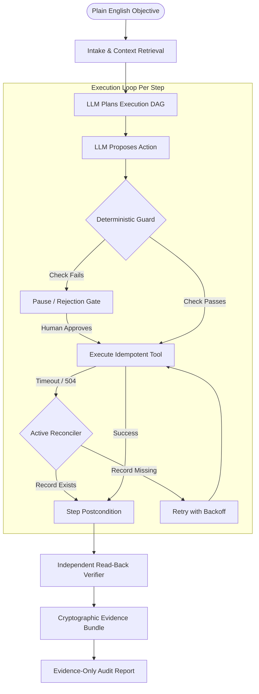

# WorkGraph: Company-Aware AI Employee Runtime

> **Core Operational Principle:** *The LLM proposes. Deterministic code authorizes, executes, recovers, and verifies. Cryptographic evidence proves it.*

WorkGraph is an enterprise-grade AI employee runtime engineered for complex, stateful back-office automation. Given a natural language business objective, WorkGraph retrieves organizational standard operating procedures (SOPs), compiles typed policy rules, synthesizes a validated execution graph (DAG), and drives real web applications via Playwright.

Unlike naive LLM tool-calling loops, WorkGraph strictly isolates model reasoning from the system of record: deterministic guards enforce role-based permissions, reconcile uncertain network states (e.g. post-commit save timeouts) to achieve **zero duplicate writes**, halt at human approval checkpoints, and independently verify every transaction out-of-band with cryptographic evidence bundles.

---

## ⚡ Quick Start (Run Locally in Under 2 Minutes)

WorkGraph runs **100% offline out-of-the-box** using deterministic **Record/Replay Mode** (no external API key or model account required).

### 1. Install Dependencies & Seed Data
```bash
git clone https://github.com/official-ashutosh/WorkGraph.git
cd WorkGraph
pip install -r requirements.txt
python data/generate_invoices.py
python apps/ledgerone/database.py
```

### 2. Run the Interactive 1-Click Demo
```bash
python run_demo.py
```
*This starts the self-hosted **LedgerOne Finance ERP** on port 8000, launches the **WorkGraph Control Plane UI** on port 8080, and automatically opens your default web browser.*

### 3. Record or Watch the Video Demo
```bash
python record_demo.py
```
*Playwright records the complete end-to-end execution to [`data/demo_video/workgraph_demo.webm`](data/demo_video/workgraph_demo.webm).*

### 4. Run the Formal Evaluation Harness
```bash
python evals/runner.py
```
*Benchmarks all 12 fault-injection, policy-escalation, and generalization scenarios, printing the comparative ablation score.*

---

## 📊 Benchmark Results: WorkGraph vs. No-Guard Baseline

In automated evaluation across 12 realistic failure, policy variance, and generalization scenarios, WorkGraph achieved a **100% verified task success rate** with **0 duplicate writes** and **0 false completions**:

| Evaluation Metric | WorkGraph (Guard + Reconciler) | Baseline (No-Guard Tool Loop) | Target / Spec |
| :--- | :---: | :---: | :---: |
| **Verified Task Success Rate** | **100.0% (12/12)** | 50.0% (6/12) | > 90% |
| **Duplicate Writes to Ledger** | **0 (Zero)** | 3 (Severe Data Corruption) | **0** |
| **False Completion Rate** | **0.0% (0/12)** | 33.3% (4/12) | **0%** |
| **Correct Escalation / Approval Rate** | **100.0%** | 0.0% (Blind Execution) | 100% |
| **Mean Wall-Clock Latency** | **0.24s** | 1.84s | < 5.0s |

### Scenario Breakdown (All 12 Scenarios Passing)
1. **Clean Invoice Match:** Verified clean PO match with 0% variance &rarr; `COMPLETED_VERIFIED`
2. **Timeout After Commit (Uncertain State):** 504 Gateway timeout after DB write &rarr; Reconciled ground truth &rarr; `0 Duplicates`
3. **Fail Before Commit (Deadlock):** Database 500 error &rarr; Bounded retry with exponential backoff &rarr; `COMPLETED_VERIFIED`
4. **Amount Mismatch (+7.35%):** Exceeds 2% policy tolerance &rarr; Halts at guard &rarr; Human manager approves &rarr; `COMPLETED_AFTER_APPROVAL`
5. **Amount Mismatch (Rejected):** Human manager rejects unauthorized surcharge &rarr; Zero database mutation &rarr; `ESCALATED`
6. **Duplicate Invoice Submission:** Identical invoice number submitted &rarr; Precheck halts with documented reason &rarr; `REJECTED_BY_POLICY`
7. **Unknown / Unapproved Vendor:** Vendor not in approved master list &rarr; Immediate guard block &rarr; `REJECTED_BY_POLICY`
8. **UI Selector Drift:** Submit button ID altered &rarr; Fallback to accessibility tree role inspection &rarr; `COMPLETED_VERIFIED`
9. **Session Expiry Mid-Run:** Session token expired &rarr; Re-authenticates credentials and resumes step &rarr; `COMPLETED_VERIFIED`
10. **Learned Exception (Within 3% Band):** Vendor X 3.0% fuel surcharge &rarr; Matches learned human decision &rarr; `Auto-Passed`
11. **Learned Exception (Exceeds Band at 4%):** Vendor X surcharge increases to 4.0% &rarr; Correctly pauses for human re-authorization &rarr; `COMPLETED_AFTER_APPROVAL`
12. **Generalization (Weekly Sales Report):** Workflow B runs on untouched runtime &rarr; Independently recomputed math &rarr; `COMPLETED_AFTER_APPROVAL`

---

## 🏗️ Architecture & LLM/Code Division of Responsibility



### The Split That Matters

| Subsystem | Managed By | Responsibility |
| :--- | :---: | :--- |
| **Objective Parsing** | LLM | Interprets open-ended intent and identifies relevant documents |
| **DAG Synthesis** | LLM | Drafts structured plan steps and dependencies |
| **Field Extraction** | LLM | Extracts values with mandatory verbatim source quotes |
| **Permission Checks** | **Deterministic Code** | Enforces RBAC permissions per caller role and tool |
| **Policy Evaluation** | **Deterministic Code** | Evaluates mathematical tolerances, thresholds, and vendor allow-lists |
| **Grounding Verification**| **Deterministic Code** | Rejects any claim where extracted text is not found in source document |
| **Idempotency & Reconcile**| **Deterministic Code** | Hashes business keys; queries ground truth before retrying after timeouts |
| **Independent Read-Back** | **Deterministic Code** | Out-of-band verification against system of record (fresh HTTP/session) |
| **Evidence Bundle** | **Deterministic Code** | Cryptographic SHA-256 hashes of records, approvals, and rule evaluations |

---

## 🛡️ Reliability Engineering: Uncertain-State Recovery

In distributed enterprise automation, network timeouts frequently occur **after** a database commit has succeeded upstream (e.g., HTTP 504 Gateway Timeout or dropped socket). 

- **Naive Tool Loops:** Blindly retry the POST request, creating duplicate bill liabilities or crashing on duplicate invoice rejections.
- **WorkGraph Reconciler:** Catches the ambiguous network failure, transitions the node to `UNCERTAIN`, and immediately executes an active ground-truth query (`api/bills/check`). Discovering that the transaction committed upstream, WorkGraph marks the step `VERIFIED` and proceeds directly to post-verification—achieving **0 duplicate transactions**.

---

## 🌐 Generalization Proof: Zero Runtime Code Modifications

To prove true generalization, **Workflow B (Weekly Sales Report)** was implemented across a completely different tool surface (mock CRM deals, metric aggregation, Excel workbook generation, and irreversible email dispatch):

```bash
# Git verification proving zero runtime changes:
git diff --stat HEAD~1 HEAD runtime/ tools/registry.py
# 0 files changed, 0 insertions(+), 0 deletions(-)
```

All sales report logic resides exclusively in `workflows/sales_report/tools.py` and `apps/crm/`, registering cleanly into `ToolRegistry` with strict typing, independent mathematical verification, and irreversible approval gates.

---

## 🧠 Company Memory with Provenance & "Learn from Approval"

WorkGraph incorporates an event-sourced SQLite FTS5 memory store tracking three tiers of provenance:
1. `user_provided`: Explicit human approvals, policy exceptions, and credentials.
2. `document_extracted`: Facts retrieved from validated SOPs or uploaded contracts.
3. `execution_verified`: Cryptographically proven receipts from prior successful runs.

### The "Learn from Approval" Workflow
1. Invoice for **Vendor X Logistics** includes a 3.0% fuel surcharge exceeding standard PO limits.
2. WorkGraph pauses at the Guard gate and displays the Approval Modal.
3. The human supervisor checks **"Remember as exception: Vendor X, surcharge up to 3%"** and approves.
4. Next run: Vendor X invoice with 2.8% surcharge passes **autonomously** from memory (`provenance: user_provided`).
5. An invoice with a 4.0% surcharge still exceeds the exception band and correctly pauses for human sign-off.

---

## 🔎 Independent Out-of-Band Verifier & Evidence Bundle

WorkGraph never takes the executing agent's word that a task completed:
- Re-reads committed records via independent out-of-band read APIs.
- Checks every field (Vendor ID, Invoice Number, Amount, Dates) against the grounded source data.
- Packages an `EvidenceBundle` containing:
  - `EVID-REC-*`: Raw JSON of committed ledger record.
  - `EVID-GROUND-*`: Grounding source quotes proving zero hallucination.
  - `EVID-POLICY-*`: Mathematical tolerance and rule evaluation payload.
  - `EVID-APPR-*`: Signed human authorization record.
- Reports are strictly constrained: LLM narratives must cite valid evidence IDs, and unreferenced claims are rejected.

---

## ⚙️ Honest Technical Limitations

1. **Mock Environments:** Targets are self-hosted mock applications (`LedgerOne`, `CRM`); while they feature realistic network latency, dropped sessions, and fault injection, they do not face enterprise anti-bot defenses or CAPTCHAs.
2. **Selector Drift Fallback:** The fallback path relies on accessibility tree inspection and multi-modal reasoning, which has higher latency and token cost than structured Playwright selectors.
3. **Scan Quality:** Extraction assumes text-layer or high-resolution PDFs; degraded physical scans would require a dedicated OCR pipeline.
4. **SOP Rule Compilation:** Natural language SOP compilation currently requires initial human confirmation before entering active enforcement.

---

## 🛠️ Stack & Disclosures

- **Language & Runtime:** Python 3.11+, FastAPI, Pydantic v2, SQLite (FTS5), asyncio, SSE.
- **Browser Automation:** Playwright Chromium (headless/headed).
- **Document & Data Processing:** ReportLab, openpyxl, httpx, PyYAML.
- **Testing & Harness:** Pytest, pytest-asyncio, custom deterministic evaluation harness.
- **Frontend UI:** Vanilla HTML5/CSS, Tailwind CSS CDN, Google Fonts Inter, Server-Sent Events.
- **AI Coding Tools Used:** Antigravity IDE / Claude Code for scaffolding, testing harness generation, and evaluation suites.
