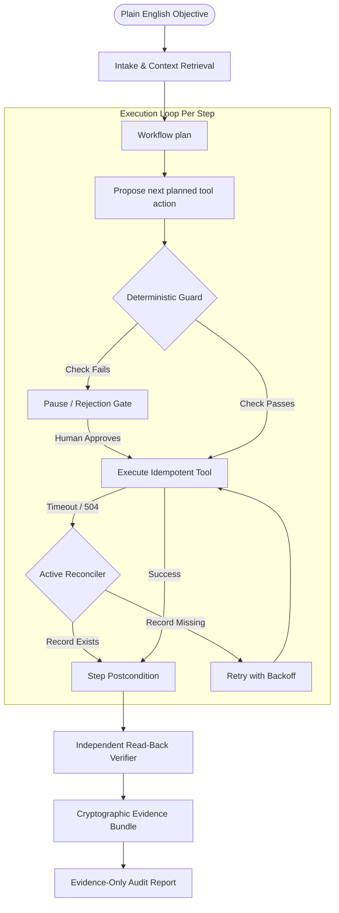

# WorkGraph: Company-Aware AI Employee Runtime

> **Core Operational Principle:** *The model proposes. Deterministic code authorizes, executes, recovers, and verifies. Evidence records what happened.*

WorkGraph is a local prototype for controlled, stateful back-office automation. It runs invoice processing and weekly sales reporting against self-hosted mock business applications, with deterministic policy checks, approval gates, recovery, and independent read-back verification. In the current offline build, plans and invoice extractions come from fixed workflow templates and replay fixtures; this demonstrates the control runtime, not open-ended live-model autonomy.

The design principle is: **proposals do not authorize mutations**. Deterministic guards enforce permissions and policy, request human approval when required, and verify saved records independently. Evidence items carry SHA-256 content hashes for integrity checks; they are not digitally signed or externally anchored.

---

## ⚡ Quick Start (Run Locally in Under 2 Minutes)

WorkGraph runs offline using deterministic **Record/Replay Mode** (no external API key required). The current provider uses stored fixtures and workflow templates; a live model-backed planner is not implemented yet.

### 1. Install Dependencies & Seed Data
```bash
git clone https://github.com/official-ashutosh/WorkGraph.git
cd WorkGraph
pip install -r requirements.txt
python data/generate_invoices.py
python apps/ledgerone/database.py
```

### 2. Run the Interactive 1-Click Demo
```bash
python run_demo.py
```
*This starts the self-hosted **LedgerOne Finance ERP** on port 8000, launches the **WorkGraph Control Plane UI** on port 8080, and automatically opens your default web browser.*

### 3. Record or Watch the Video Demo
```bash
python record_demo.py
```
*Playwright records the complete end-to-end execution to [`data/demo_video/workgraph_demo.webm`](data/demo_video/workgraph_demo.webm).*

### 4. Run the Formal Evaluation Harness
```bash
python evals/runner.py
```
*Benchmarks all 12 fault-injection, policy-escalation, and generalization scenarios, printing the comparative ablation score.*

### Deploy with Docker Compose
```bash
docker compose up --build -d
docker compose ps
```

Open the UI at `http://localhost:8080`; LedgerOne is at `http://localhost:8000`. Compose persists runtime databases and generated reports in the `workgraph_state` volume. Use `docker compose logs -f workgraph` to inspect startup and `docker compose down` to stop without deleting state.

**Security:** This is a mock/demo application with unauthenticated control APIs and seeded LedgerOne credentials. Compose binds ports to localhost by default. Do not expose it directly to the public internet; use a trusted network or an authenticated TLS reverse proxy. Setting `WORKGRAPH_BIND_ADDRESS=0.0.0.0` or `LEDGERONE_BIND_ADDRESS=0.0.0.0` exposes the service on all host interfaces.

---

## 📊 Measured Guard Ablation

The harness runs each of 12 scenarios twice from a reset app state. Both arms use the same planner, executor, reconciliation, independent verifier, and mock LedgerOne app; only the WorkGraph guard (grounding, permissions, policy decisions, and approval gates) is disabled in the baseline. This isolates guard behavior, not the value of reconciliation. LedgerOne also rejects duplicate vendor/invoice pairs itself, so this experiment does not claim the guard alone prevents duplicate rows.

Latest local run:

| Evaluation Metric | Guarded | Guard Disabled | Target |
| :--- | :---: | :---: | :---: |
| **Expected Outcome Match** | **100.0% (12/12)** | 50.0% (6/12) | Report measured |
| **Unsafe Completion / Approval Bypass** | **0 (0.0%)** | 5 (41.7%) | **0** |
| **Duplicate Rows** | **0** | 0 | **0** |
| **Mean Execution Steps** | **7.4** | 7.9 | Report measured |

The guard-disabled arm completes several actions that should have paused or been rejected. Duplicate rows remain at zero because the application itself rejects duplicates. Full per-scenario outcomes and measured timing are written to [`evals/report.md`](evals/report.md) whenever the harness runs.

### Guarded Scenario Results
1. **Clean Invoice Match:** Verified clean PO match with 0% variance &rarr; `COMPLETED_VERIFIED`
2. **Timeout After Commit (Uncertain State):** 504 Gateway timeout after DB write &rarr; Reconciled ground truth &rarr; `0 Duplicates`
3. **Fail Before Commit (Deadlock):** Database 500 error &rarr; Bounded retry with exponential backoff &rarr; `COMPLETED_VERIFIED`
4. **Amount Mismatch (+7.35%):** Exceeds 2% policy tolerance &rarr; Halts at guard &rarr; Human manager approves &rarr; `COMPLETED_AFTER_APPROVAL`
5. **Amount Mismatch (Rejected):** Human manager rejects unauthorized surcharge &rarr; Zero database mutation &rarr; `ESCALATED`
6. **Duplicate Invoice Submission:** Identical invoice number submitted &rarr; Precheck halts with documented reason &rarr; `REJECTED_BY_POLICY`
7. **Unknown / Unapproved Vendor:** Vendor not in approved master list &rarr; Immediate guard block &rarr; `REJECTED_BY_POLICY`
8. **Selector Drift Fault:** The fault is seeded, but this eval uses the direct HTTP adapter; it does not test the Playwright fallback.
9. **Session Expiry Mid-Run:** Session token expired &rarr; Re-authenticates credentials and resumes step &rarr; `COMPLETED_VERIFIED`
10. **Learned Exception (Within 3% Band):** Vendor X 3.0% fuel surcharge &rarr; Matches learned human decision &rarr; `Auto-Passed`
11. **Learned Exception (Exceeds Band at 4%):** Vendor X surcharge increases to 4.0% &rarr; Correctly pauses for human re-authorization &rarr; `COMPLETED_AFTER_APPROVAL`
12. **Generalization (Weekly Sales Report):** Workflow B runs on untouched runtime &rarr; Independently recomputed math &rarr; `COMPLETED_AFTER_APPROVAL`

---

## 🏗️ Architecture & LLM/Code Division of Responsibility



### The Split That Matters

| Subsystem | Managed By | Responsibility |
| :--- | :---: | :--- |
| **Workflow selection / planning** | Fixed templates | Selects predefined invoice or sales-report steps; no live objective-to-plan model call yet |
| **Field extraction** | Replay fixtures | Supplies deterministic extracted fields and quotes for seeded invoices |
| **Permission Checks** | **Deterministic Code** | Enforces RBAC permissions per caller role and tool |
| **Policy Evaluation** | **Deterministic Code** | Evaluates mathematical tolerances, thresholds, and vendor allow-lists |
| **Grounding Verification**| **Deterministic Code** | Checks seeded invoice number, vendor, and amount against extracted source text before downstream steps |
| **Idempotency & Reconcile**| **Deterministic Code** | Hashes business keys; queries ground truth before retrying after timeouts |
| **Independent Read-Back** | **Deterministic Code** | Out-of-band verification against system of record (fresh HTTP/session) |
| **Evidence Bundle** | **Deterministic Code** | Cryptographic SHA-256 hashes of records, approvals, and rule evaluations |

---

## 🛡️ Reliability Engineering: Uncertain-State Recovery

In distributed automation, a network timeout can occur **after** a database commit has succeeded upstream. The seeded LedgerOne fault reproduces this case.

- **WorkGraph Reconciler:** Marks the write uncertain and checks the app's read endpoint before retrying. When the saved bill is found, the run continues without another write.
- **What the current eval proves:** The timeout-after-commit scenario recovers correctly. The guard ablation keeps reconciliation enabled in both arms, and LedgerOne independently rejects duplicate invoices; neither fact should be presented as a measured guard-only reduction in duplicates.

---

## 🌐 Second Workflow: Shared Runtime, Not Yet Zero-Edit Generalization

The weekly sales-report scenario exercises the same step executor, guard, approval, and verification path using mock CRM data and Excel generation. The final email tool is a mock dispatch, not an external email integration.

This is a second workflow on shared runtime components, but it does **not** yet prove that a new workflow can be added without runtime edits: the current orchestrator imports the sales tools explicitly, and the planner contains a sales-specific plan branch. A plugin or declarative workflow contract is needed to make that claim true.

The sales tools are in [`workflows/sales_report/tools.py`](workflows/sales_report/tools.py) and [`apps/crm/data.py`](apps/crm/data.py). The guard-disabled ablation measures approval bypass on this scenario; it does not send an actual email.

---

## 🧠 Company Memory with Provenance & "Learn from Approval"

WorkGraph incorporates an event-sourced SQLite FTS5 memory store tracking three tiers of provenance:
1. `user_provided`: Explicit human approvals, policy exceptions, and credentials.
2. `document_extracted`: Facts retrieved from validated SOPs or uploaded contracts.
3. `execution_verified`: Cryptographically proven receipts from prior successful runs.

### The "Learn from Approval" Workflow
1. Invoice for **Vendor X Logistics** includes a 3.0% fuel surcharge exceeding standard PO limits.
2. WorkGraph pauses at the Guard gate and displays the Approval Modal.
3. The human supervisor checks **"Remember as exception: Vendor X, surcharge up to 3%"** and approves.
4. Next run: Vendor X invoice with 2.8% surcharge passes **autonomously** from memory (`provenance: user_provided`).
5. An invoice with a 4.0% surcharge still exceeds the exception band and correctly pauses for human sign-off.

---

## 🔎 Independent Out-of-Band Verifier & Evidence Bundle

WorkGraph never takes the executing agent's word that a task completed:
- Re-reads committed records via independent out-of-band read APIs.
- Checks every field (Vendor ID, Invoice Number, Amount, Dates) against the grounded source data.
- Packages an `EvidenceBundle` containing:
  - `EVID-REC-*`: Raw JSON of committed ledger record.
  - `EVID-GROUND-*`: Extracted fields and source quotes used by the grounding check.
  - `EVID-POLICY-*`: Mathematical tolerance and rule evaluation payload.
  - `EVID-APPR-*`: Human approval decision record (not a digital signature).
- Evidence items include SHA-256 hashes, but are not signed or externally anchored. Treat the bundle as audit-supporting evidence, not tamper-proof attestation.
- The replay reporter emits evidence IDs; a live model-generated narrative with citation validation is not currently exercised.

---

## ⚙️ Honest Technical Limitations

1. **Mock Environments:** `LedgerOne` and `CRM` are self-hosted test applications; the email dispatch is also mocked. Results do not establish reliability on third-party SaaS products.
2. **Model Autonomy:** The offline provider uses fixed plans and replay fixtures. Live objective-to-plan generation and general-purpose SOP compilation are not currently implemented.
3. **Browser Path:** Invoice evaluations use the direct app test client by default; the Playwright adapter exists but is not the measured path in the eval harness.
4. **Workflow Extension:** Sales planning and tool loading currently contain workflow-specific runtime wiring, so the zero-runtime-edit criterion remains open.
5. **Evidence Trust:** SHA-256 hashes detect changes only when compared with trusted originals; there is no signature, append-only external anchor, or key management.
6. **Scan Quality:** Degraded physical scans would require a dedicated OCR pipeline.

---

## 🛠️ Stack & Disclosures

- **Language & Runtime:** Python 3.11+, FastAPI, Pydantic v2, SQLite (FTS5), asyncio, SSE.
- **Browser Automation:** Optional Playwright Chromium adapter; evals currently use the direct test-client path.
- **Document & Data Processing:** ReportLab, openpyxl, httpx, PyYAML.
- **Testing & Harness:** Pytest, pytest-asyncio, custom deterministic evaluation harness.
- **Frontend UI:** Vanilla HTML5/CSS, Tailwind CSS CDN, Google Fonts Inter, Server-Sent Events.
- **AI Coding Tools Used:** Antigravity IDE / Claude Code for scaffolding, testing harness generation, and evaluation suites.
